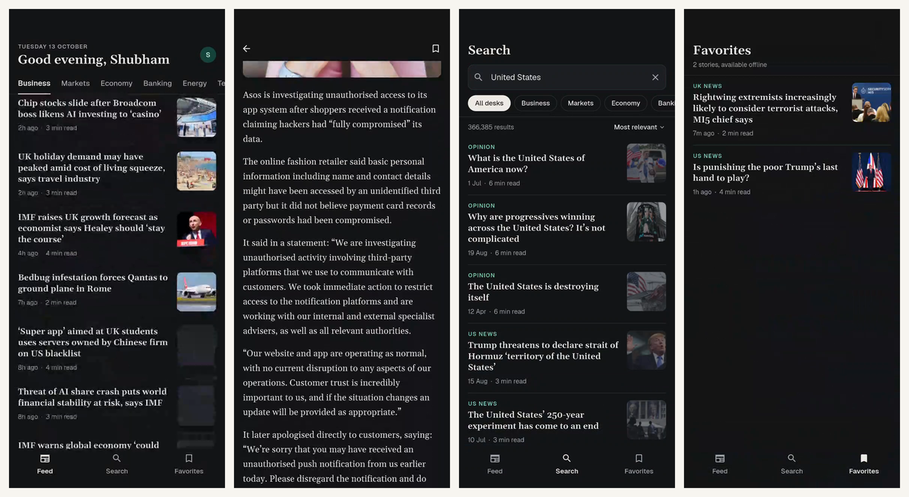

# News Intelligence

A Flutter app for following business news. It reads live stories from The Guardian Open Platform, groups them into business desks, and lets you search, read full articles and keep favorites that work offline.

Built for the Mini News Intelligence assignment with Flutter, Riverpod and Hive.

## Demo

[](docs/demo.mp4)

[Watch the screen recording](docs/demo.mp4) (70 seconds, Android, dark mode): browsing desks, reading an article, searching, saving a favorite and the offline message.

## What it does

* **Sign in**: a simple email and password login. The session is stored on the device, so the app opens straight to the feed next time.
* **Feed**: six desks (Business, Markets, Economy, Banking, Energy, Technology), endless paging and pull to refresh.
* **Search**: searches every story through the API, narrowed by desk and sorted by relevance or date.
* **Article**: the full story with byline, publication date and reading time, a bookmark to save it, and a link to the original.
* **Favorites**: saved with the full text in Hive, so they open without a connection. Swipe to remove, with undo.

## Running the app

1. Install Flutter 3.35 or newer. The app was built and tested with Flutter 3.44.8.
2. Get a free developer key from [The Guardian Open Platform](https://open-platform.theguardian.com/access/). It arrives by email within a minute.
3. Create your local environment file from the example and put the key in it:

```sh
cp .env.example .env
```

```text
GUARDIAN_API_KEY=your_key
```

4. Run the app:

```sh
flutter pub get
flutter run
```

The key is loaded at startup with `flutter_dotenv`. `.env` is ignored by git, so the key never ends up in the repository, while `.env.example` shows what the file needs. The file must exist for the build because it is bundled as an asset. If the key inside it is missing, the app still starts and explains that one is needed.

Like any key shipped inside a mobile app, it can be read from the app bundle. A production app would call the API through its own backend instead.

In debug builds every API request and response (URL, query parameters, headers and body) is printed to the console through `debugPrint` with `pretty_dio_logger`. Release builds log nothing. The printed query parameters include the API key, so take care when sharing debug logs.

To sign in, use any email address and a password with at least 6 characters.

Run the tests with:

```sh
flutter test
```

## Architecture

The code is organised by feature, and each feature has three layers:

* **domain**: plain Dart entities and repository contracts. No Flutter, Dio or Hive imports, so this layer has no idea where data comes from.
* **data**: repository implementations. They call the Guardian API through Dio or read and write Hive, and turn the results into domain entities.
* **presentation**: Riverpod notifiers that hold screen state, and the screens and widgets that render it.

Dependencies point inwards: presentation and data both depend on domain, never on each other's details. Riverpod providers do the dependency injection. Each repository provider sits next to its implementation but is typed as the domain contract, so screens only ever see `NewsRepository`, `FavoritesRepository` or `AuthRepository`, and a test can replace any of them with one override.

```text
Screen ──watches──▶ Notifier ──calls──▶ Repository contract (domain)
                                               ▲
                                               │ implements
                         GuardianNewsRepository, HiveFavoritesRepository,
                         LocalAuthRepository (data)
                                               │
                                     ApiClient (Dio) or a Hive box
```

## Folder structure

```text
lib/
├── main.dart                  Opens Hive, then starts the app
├── app/
│   ├── app.dart               MaterialApp, themes and the sign in gate
│   └── home_shell.dart        Bottom navigation for Feed, Search and Favorites
├── core/                      Shared code with no feature knowledge
│   ├── config/                API settings
│   ├── error/                 Sealed Failure types
│   ├── network/               Dio client, debug logging, error mapping and the retry rule
│   ├── storage/               Hive setup and safe writes
│   ├── theme/                 Colors and typography
│   ├── utils/                 Date formatting and a provider cache helper
│   └── widgets/               Message, skeleton and snack bar helpers
└── features/
    ├── auth/
    │   ├── data/              LocalAuthRepository backed by a Hive session box
    │   ├── domain/            AppUser and AuthRepository
    │   └── presentation/      AuthController and LoginScreen
    ├── news/
    │   ├── data/              ArticleModel and GuardianNewsRepository
    │   ├── domain/            Article, ArticlePage, NewsCategory, SearchSort, NewsRepository
    │   └── presentation/      Paging notifiers, Feed, Search and Article screens, list widgets
    └── favorites/
        ├── data/              HiveFavoritesRepository
        ├── domain/            FavoritesRepository
        └── presentation/      FavoritesNotifier and FavoritesScreen
```

Tests mirror this layout under `test/`.

## Key decisions

### The Guardian Open Platform as the news API

* It is the official API of a major newsroom, has been running since 2009, and the free developer key allows 500 calls a day.
* It returns the full article body. The article screen shows the whole story inside the app, and favorites keep that text for offline reading. The free NewsAPI plan, the usual alternative, cuts content short, delays articles by 24 hours and is limited to development use.
* The body comes with the list request, so opening an article needs no second call. Its HTML is turned into plain paragraphs while parsing, leaving out embedded media and related links.
* Every request asks only for articles (`type=article`), so live blogs, galleries and video never reach the reading view. Desks map to Guardian sections and tags.

### State management with Riverpod 3

* **Feed**: one `AsyncNotifier` per desk (a family). Pages stay in memory for the session, the next page loads as the reader nears the end, and pull to refresh reloads page one while the current stories stay visible. A page that arrives after a refresh is dropped, so the list never mixes old and new results. The paging logic lives in `PagedArticlesNotifier` and is shared with search.
* **Search**: every distinct query (text, desk and sort) gets its own auto disposed provider. That makes debouncing simple, because a query replaced during the 450 ms pause is disposed before its request goes out. It also means a slow response can never overwrite newer results. Results stay cached for five minutes after the user moves on, so switching filters back and forth repeats no requests.
* **Retries**: Riverpod 3 retries failed providers automatically, up to ten times. Offline, that would leave people watching a spinner for about forty seconds, so the app only retries rate limit responses, twice and a second apart. The free key allows one request per second.

### Local storage with Hive

* The app uses `hive_ce`, the maintained community edition of Hive, because the original package has not had a stable release since 2022.
* There are two boxes: `session` holds the signed in email, and `favorites` holds full articles as plain maps keyed by article id. Plain maps avoid generated type adapters and keep the stored shape easy to read.
* Boxes are opened before the first frame, so reads are synchronous. A returning user lands on the feed without a loading flash.

### Error handling

* A small sealed `Failure` hierarchy covers network, rate limit, API key, server and storage problems. Dio and Hive errors are translated at the edges, and screens switch over the sealed type to choose the right icon, title and message.
* Every async screen covers loading (skeletons shaped like the content), empty, error with retry, and a failed next page, which shows an inline retry while the list stays put. A failed refresh keeps the current stories and explains the problem in a snack bar.
* Removing a favorite updates the list first and rolls back if the write fails.

### Authentication

* There is no auth backend in scope, so `LocalAuthRepository` stands in for one behind the `AuthRepository` contract. It accepts any valid email with a password of at least 6 characters and stores only the email, never the password. Moving to Firebase or a REST backend means writing one new repository class.
* With a real backend, the session token would go to secure storage (Keychain or Keystore) instead of Hive.

### Left out on purpose

* **Use case classes**: each one would only pass a call through to a repository. The repository contracts already keep screens independent of data sources, and use cases can come in once there are real business rules.
* **Code generation** (freezed, json_serializable, riverpod_generator, Hive adapters): the models are small, hand written mapping is easy to follow, and setup stays a single command.
* **go_router**: five screens with one pushed route are easy to follow with the standard Navigator.
* **Separate data source classes**: each repository has exactly one source today. They are worth adding when the feed gets its own offline cache.

### Interface

* An editorial look: warm paper background, Gelasio serif for headlines and reading, Geist for interface text, and a single deep green accent. Light and dark themes follow the system setting.
* Fonts are bundled with the app, so typography is right from the first launch, even offline.
* Loading skeletons mirror the final layout and stay still when the system asks for reduced motion.

## Testing

`flutter test` runs unit tests for the Guardian parser, failure mapping and the retry rule, the paging notifier (including a page that arrives after a refresh), the Hive favorites repository, date formatting and the greeting name.

## What I would add next

* An offline cache for the feed itself, not only for favorites.
* Favorites stored per user, once there is a real backend.
* Widget and integration tests for the main flows.
